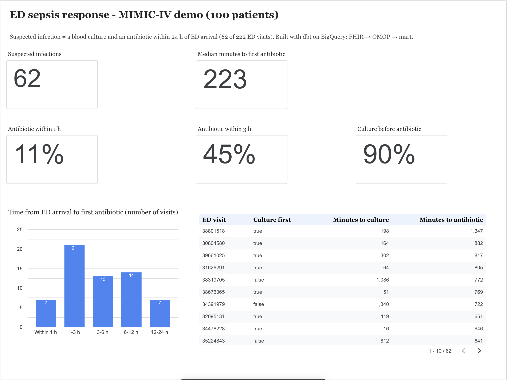

# FHIR to OMOP sepsis pipeline

This is a data pipeline I built on the MIMIC-IV demo, which has real, de-identified hospital records for 100 patients.
It loads the raw FHIR files into BigQuery, reshapes them into the OMOP common data model with dbt, and uses the result to answer one question: when someone comes to the emergency department (ED) with a possible infection, how long does it take to draw a blood culture and give the first antibiotic?



Live dashboard: [ED sepsis response](https://datastudio.google.com/reporting/91aabda6-d417-4e40-9b28-6d2d5a6908f5)

Built with Python 3.13, Cloud Storage, BigQuery, dbt 2.0 and Data Studio (formerly Looker Studio).

## Why I made this

I want to study healthcare datasets, and this project is where I started.
I don't come from a clinical background, so I took one real dataset from raw files to a dashboard and learned how a hospital records visits, specimens and medicines on the way.
MIMIC-IV comes from Beth Israel Deaconess Medical Center in Boston, and its 100-patient demo is open data, so the code and results can be public.
I picked sepsis because the guidelines set clear time targets that I could check against the timestamps.

## The question

Sepsis is when the body's response to an infection starts damaging its own organs, and it can get worse within hours.
The Surviving Sepsis Campaign guidelines (2021) ask for antibiotics within 1 hour when sepsis is likely and within 3 hours when it's only possible, with blood cultures taken first.
For each ED visit, the mart `ed_sepsis_timing` finds the first blood culture and the first antibiotic in the 24 hours after arrival and counts the minutes to each.
A visit with both counts as a suspected infection.

## Results

| Measure | Value |
|---|---|
| ED visits | 222, from 64 patients |
| Suspected infections | 62 |
| Antibiotic within 1 hour | 7 of 62 (11%) |
| Antibiotic within 3 hours | 28 of 62 (45%) |
| Median time to first antibiotic | 230.5 minutes |
| Median time to first blood culture | 48 minutes |
| Blood culture before the antibiotic | 56 of 62 (90%) |

The dashboard shows 223 for the median because Data Studio returned one of the two middle values (223 and 238) instead of their average.
With only 100 patients, these numbers can't say anything about the hospital's sepsis care.
MIMIC shifts every patient's dates into the future (2112 to 2201 here), but the minutes between events are real.

## How it works

```text
PhysioNet: 30 FHIR files (.ndjson.gz, 52 MB)
  -> Cloud Storage                   raw files, unchanged
  -> bronze.fhir_resources           928,935 rows, one FHIR resource per row as JSON
  -> silver (16 dbt models)          JSON flattened into typed columns
  -> gold (8 OMOP CDM v5.4 tables)   codes mapped with the OMOP vocabulary from Athena
  -> marts.ed_sepsis_timing          one row per ED visit
  -> Data Studio dashboard
```

`ingest/` holds the two Python loaders (FHIR files and vocabulary), and `fhir_omop/` is the dbt project.

## Design decisions

- Bronze keeps each resource as raw JSON, so I can rebuild silver at any time without downloading anything again.
- Antibiotics come from the vocabulary: every drug under the ATC class J01 (6,301 concepts), minus eye drops, oral vancomycin and neomycin, which don't treat an infection in the blood.
- Cultures and doses are matched to a visit by person and time, because OMOP's specimen table has no visit column and MIMIC's ward doses point to the hospital stay.
- The window ends early at the person's next ED arrival, because one ED stay can be split into two visit ids.
- `drug_exposure` keeps the ED medication cabinet records, since without them 53 of the 83 first-antibiotic times would be wrong.

## Things I learned about the data

- MIMIC's ICD codes have no dots (`4019` for `401.9`), and before I added them only 251 of the 5,051 diagnoses matched the vocabulary.
- The same code can mean different things: `E871` is hyponatremia in ICD-10 and a foreign object left in the body in ICD-9, and `2106-3` is the CDC race code for White but a urine pregnancy test in LOINC.

## Data engineering notes

- Every step is safe to rerun: downloads and uploads skip finished files, bronze deletes a file's rows before reloading it, and dbt rebuilds every table from bronze.
- A failed run never leaves half-written data, because BigQuery load jobs and dbt's `CREATE OR REPLACE TABLE` either fully succeed or change nothing.
- The ingest scripts compare row counts with the source files, and `dbt build` runs 185 tests (not_null, unique, relationships, accepted values and a few from dbt_utils).
- A failing test skips everything downstream, so the dashboard keeps the last good data.
- A new or renamed FHIR field can't break the bronze load, and a field that disappears turns into NULLs that the not_null tests catch.
- BigQuery costs stay small: load jobs are free, and `maximum_bytes_billed` stops any query that would scan more than 10 GB.
- There are no service account keys or data files in the repo, and the dashboard is shared for viewing only, so viewers see the charts but can't open the BigQuery project.
- Times are stored as Boston local time in DATETIME columns, the type OMOP uses, and none of the measured intervals crosses a daylight saving change.
- Everything is full refresh and run by hand, which suits a dataset that only changes with each release.
  CI with GitHub Actions and a scheduler are the next things I'd add.

## Limitations

- The clock starts at ED arrival, because the data doesn't record when someone first suspected sepsis.
- "Suspected infection" is a simple 24-hour rule, and with no SOFA score yet, the mart doesn't say who had sepsis.
- The `BLOOD CULTURE` label and the antibiotic name filters are MIMIC's own text, so another hospital's data would need different filters.
- Gold has 8 OMOP tables so far, and `measurement` (labs and vital signs) is the next one.

## Data

The data is the [MIMIC-IV Clinical Database Demo on FHIR](https://physionet.org/content/mimic-iv-fhir-demo/2.1.0/) (v2.1.0) from PhysioNet, released under the Open Database License (ODbL).
If you use it, please cite it the way that page asks.
The data files and the Athena vocabulary aren't included in this repo.
